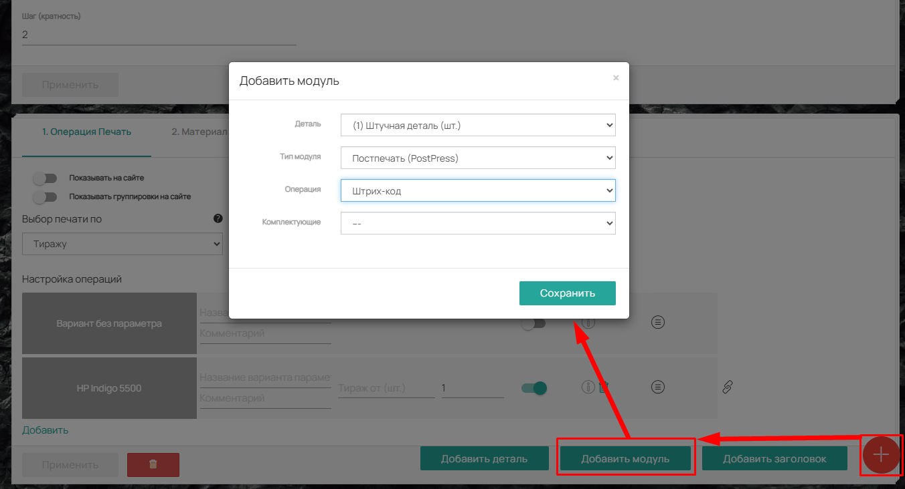
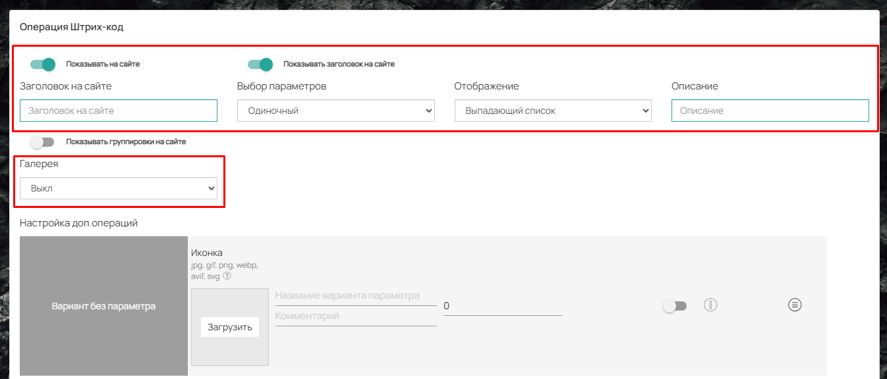
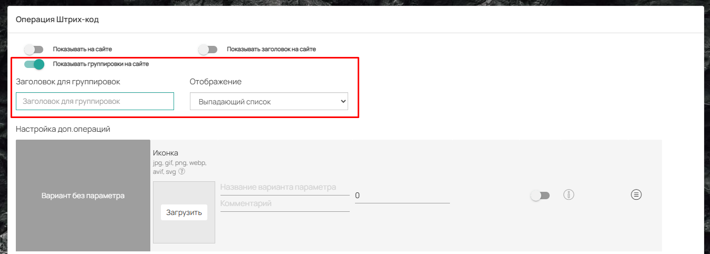
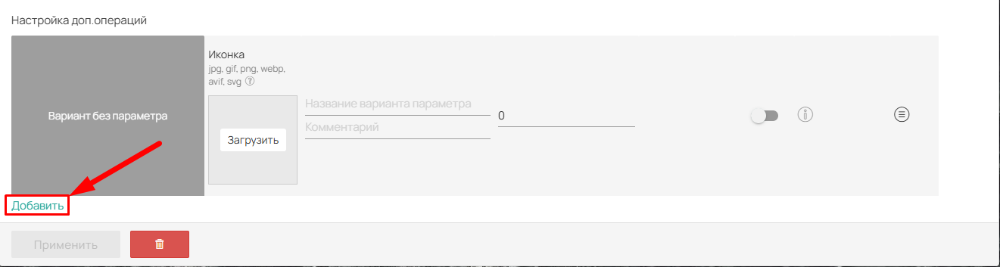
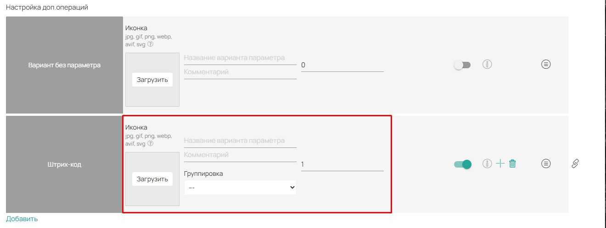
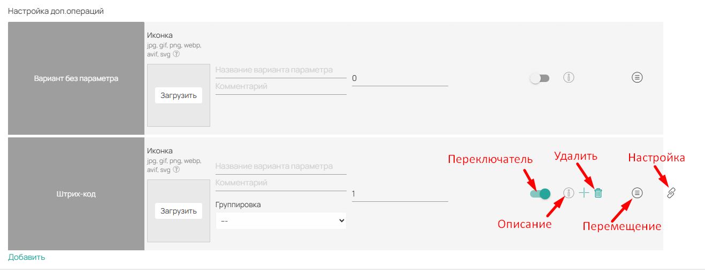
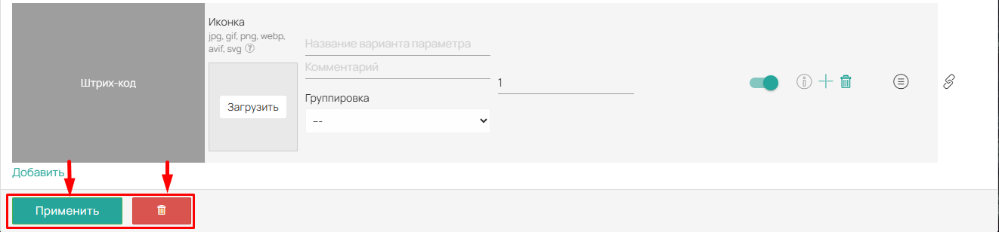

**Модуль «Штрих-код»** предназначен для расчёта нанесённых штрих-кодов на продукцию.

## **Добавление модуля в калькуляцию**

Чтобы добавить операцию Штрих-код в расчет стоимости продукта:

1. В правом нижнем углу экрана нажмите кнопку **«Плюсик»**.

2. В появившемся меню выберите пункт **«Добавить модуль»**.

3. В открывшемся окне укажите:

   -  **Деталь** -- выберите из списка деталь, к которой будет относиться Штрих-код.

   -  **Тип модуля** -- установите значение **«Постпечать»**.

   -  **Операция** -- выберите **«Штрих-код»**.

4. Нажмите кнопку **«Сохранить»**.

Модуль появится в структуре калькуляции выбранной детали.

{width=1352px height=732px}

### **Верхняя панель (Отображение на сайте)**

В верхней части модуля расположены настройки, отвечающие за то, как Штрих-код будет отображаться в карточке товара на сайте вашей типографии.

-  **Показывать на сайте** -- главный переключатель. Если он активен, блок Штрих-кода будет виден в карточке товара.

   -  **Заголовок на сайте** -- позволяет изменить стандартное название модуля. Например, вместо «Операция» можно указать «Штрих-код».

   -  **Выбор параметров** -- позволяет разрешить заказчику выбрать несколько вариантов Штрих-кода одновременно или только один.

   -  **Отображение** -- выбор внешнего вида опций на сайте: выпадающий список, радио баттон, иконки, плитка и другие варианты.

   -  **Описание** -- текст, который будет отображаться под заголовком модуля в карточке товара.

   -  **Галерея** -- включает показ галереи изображений. Фотографии загружаются в настройке операции во вкладке **«Фотогалерея»**.

-  **Показывать заголовок на сайте** -- управляет отображением заголовка модуля.

{width=1346px height=576px}

-  **Показывать группировки на сайте** -- если у вас есть группировки операций, этот переключатель позволит отобразить их для выбора клиенту. При включении появляются два поля:

   -  **Заголовок для группировок** -- название блока с группировками.

   -  **Отображение** -- формат показа группировок (список, радиокнопки, иконки и т.д.).

{width=1346px height=482px}

### Добавление операции

В этом блоке добавляются конкретные операции, с которыми выполняется Штрих-код.

-  По умолчанию присутствует **«Вариант без параметра»**.

-  Для добавления операции нажмите кнопку **«Добавить»**. Выберите существующую операцию из списка или создайте новую (см. статью [Штрих-код](./../../../../spravochnik/dop-operacii/shtrikh-kod))

{width=1321px height=353px}

#### **Настройка добавленной операции:**

-  **Иконка** -- изображение, отображаемое на сайте при выборе формата отображения «Иконки», «Плитка» или «Радио баттон с иконками».

-  **Название варианта параметра** -- наименование, которое увидит клиент на сайте.

-  **Комментарий** -- внутренняя заметка для менеджеров (видна только в панели управления).

-  **Количество:** Коэффициент, на который умножается стоимость операции. По умолчанию равен 1

{width=1320px height=498px}

Для каждого варианта в списке доступны следующие действия:

-  **Переключатель (Вкл/Выкл):** Позволяет временно скрыть вариант из расчетов и с сайта без его удаления.

-  **Описание (i):** Пояснение к данному типу Штрих-кода. Отображается как всплывающая подсказка при наведении на название на сайте.

-  **Удалить (Корзина):** Полностью удаляет вариант из модуля.

-  **Перемещение (≡):** Позволяет изменить порядок отображения вариантов в списке на сайте.

-  **Настройка (Двойная скрепка):** Переход к детальной настройке выбранного варианта Штрих-кода (см. статью [Штрих-код](./../../../../spravochnik/dop-operacii/shtrikh-kod)).

{width=1318px height=507px}

#### Управление модулем

В нижней части каждого модуля расположена панель управления:

-  **Кнопка «Применить»:** Становится активной (зеленой) при внесении изменений в настройки. **Обязательно нажимайте эту кнопку для сохранения конфигурации модуля.**

-  **Кнопка «Удалить» (Корзина):** Полностью удаляет модуль  из калькуляции.

{width=1322px height=308px}