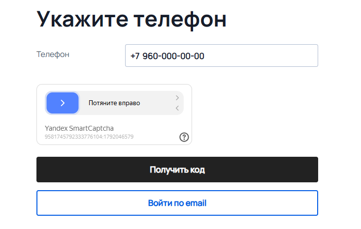
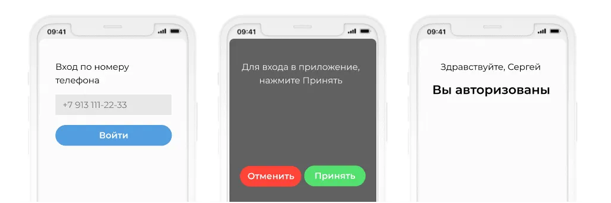
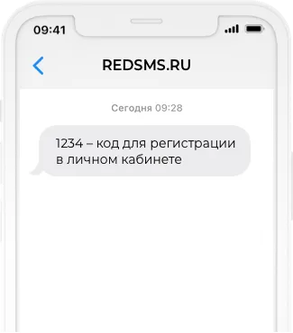
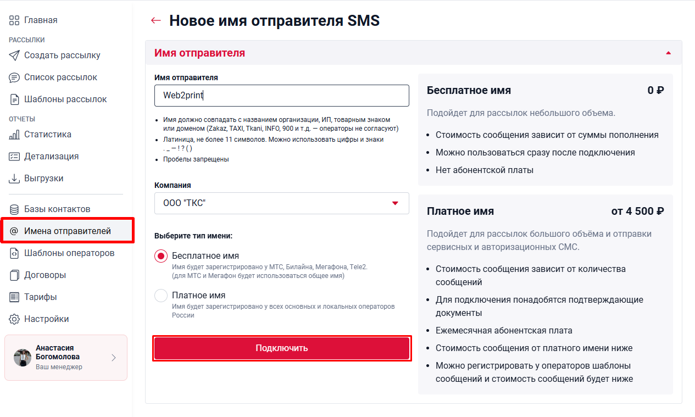
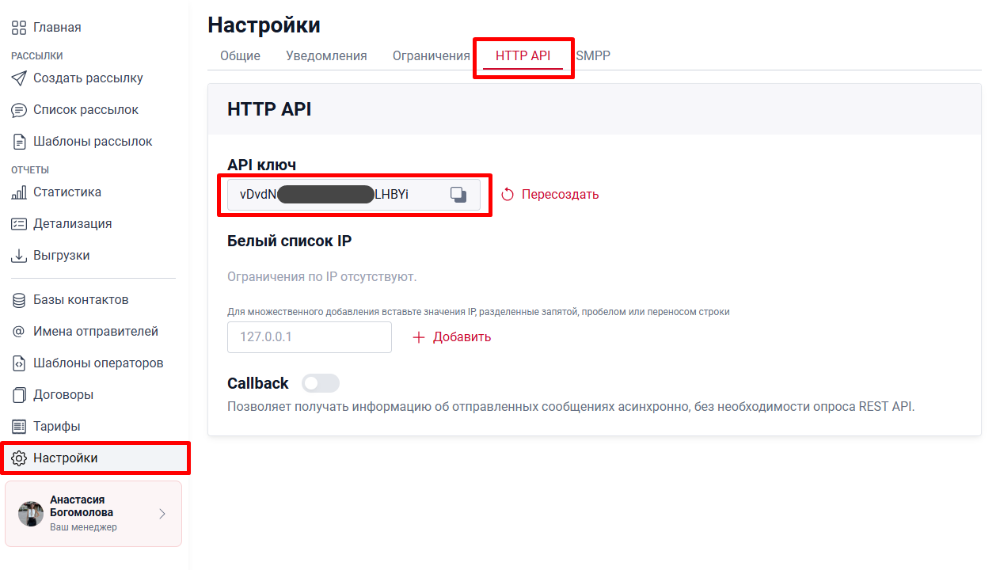
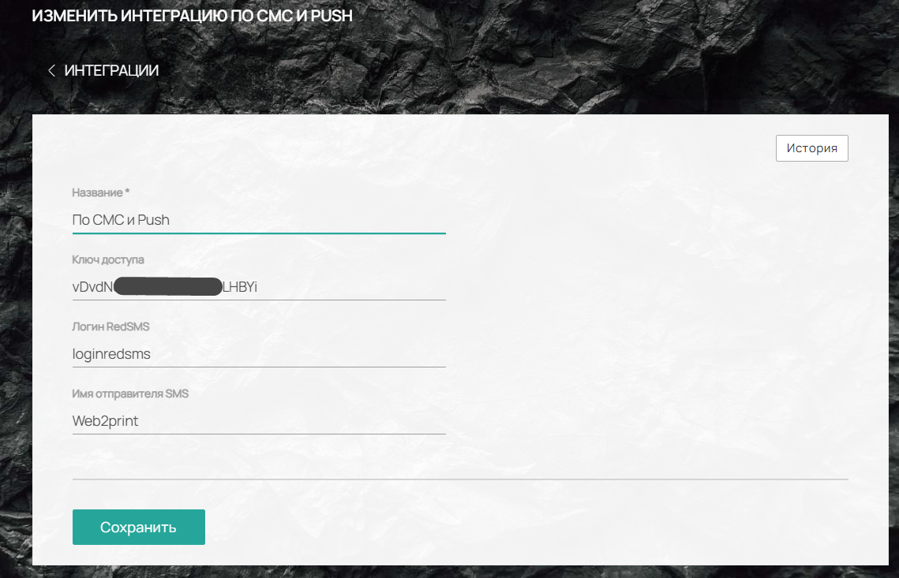

**Настройка авторизации по номеру телефона через REDSMS**

В нашей платформе реализована возможность входа в личный кабинет и на сайт вашей типографии по номеру телефона без ввода пароля. Данный функционал работает на базе интеграции с сервисом **REDSMS**.

Ниже приведена подробная инструкция по подключению и настройке данной функции.

{width=733px height=466px}

## **Принцип работы авторизации**

При входе по номеру телефона система отправляет запрос на подтверждение. Сценарий зависит от оператора связи:

1. **Основные операторы (Билайн, Мегафон, МТС, Т2):** Пользователю приходит [Push-уведомление](https://redsms.ru/services/sim-push-autentifikatsiya/) с кнопкой подтверждения входа.

   {width=1036px height=346px}

   

2. **Другие операторы:** Сразу отправляется [SMS-сообщение](https://redsms.ru/services/sms-rassylka/) с кодом.

   {width=325px height=370px}

   

3. **Резервный сценарий:** Если Push-уведомление не пришло в течение 15 секунд (для основных операторов), система автоматически отправит SMS.

4. **Повторная отправка:** Запросить SMS повторно можно не ранее чем через 60 секунд.

## **Инструкция по настройке интеграции**

Для начала работы вам необходимо зарегистрировать аккаунт в сервисе REDSMS и получить доступы.

### **Шаг 1. Регистрация и заключение договора**

1. Перейдите на официальный сайт сервиса: <https://redsms.ru/>.

2. Зарегистрируйте личный кабинет.

3. Свяжитесь с менеджером REDSMS для заключения договора на оказание услуг.

### **Шаг 2. Регистрация имени отправителя**

В личном кабинете REDSMS необходимо создать имя, от которого будут приходить сообщения вашим клиентам.

1. Перейдите в раздел **«Имена отправителей»**.

2. Нажмите **«Добавить новое имя»** и выберите тип **SMS**.

3. Введите желаемое имя, соблюдая условия сервиса (описаны на сайте).

4. Выберите вашу компанию (должна быть зарегистрирована заранее).

5. Выберите тип имени: **Бесплатное** или **Платное**. Ознакомьтесь с условиями и выберите подходящий вариант.

6. Нажмите кнопку **«Подключить»**.

{width=1265px height=759px}

### **Шаг 3. Получение API-ключа**

Для связи платформы с сервисом необходим ключ доступа.

1. В личном кабинете REDSMS перейдите в раздел **Настройки -> HTTP API**.

2. Скопируйте ваш **API ключ**.

{width=1263px height=720px}

### **Шаг 4. Настройка на платформе**

Теперь необходимо ввести полученные данные в настройках вашего сайта на нашей платформе.

1. Перейдите в раздел **Настройки -> Интеграции -> Сервисы авторизации -> RED SMS**.

2. Заполните поля следующими данными:

   -  **Ключ доступа:** Вставьте API-ключ, скопированный в личном кабинете REDSMS.

   -  **Логин REDSMS:** Укажите логин, который вы используете для входа на сайт REDSMS.

   -  **Имя отправителя SMS:** Укажите имя, зарегистрированное в разделе «Имена отправителей».

{width=1139px height=733px}

### **Шаг 5. Пополнение баланса**

Для отправки сообщений необходимо пополнить баланс в личном кабинете REDSMS. После пополнения интеграция готова к работе.

---

## Дополнительная информация

:::info 

**Обратите внимание!**

Первые отправленные сообщения проходят **ручную модерацию** в сервисе REDSMS. В связи с этим доставка может занимать длительное время (2–3 минуты).

Если вы хотите отключить ручную модерацию для ускорения работы, рекомендуется обратиться в техническую поддержку REDSMS.

:::

### **Стоимость**

-  **Стоимость отправки.** Ориентировочная цена за одну SMS начинается от **3,75 рубля** (зависит от оператора и типа сообщения). Push-уведомление от 2,5 рубля. Точные тарифы уточняйте у менеджера REDSMS.

### Безопасность

-  **IP-белый список.** В разделе **Настройки -> HTTP API** рекомендуется указать IP-адреса вашего сервера. Это защитит API-ключ от несанкционированного использования и предотвратит хищение баланса.

По всем вопросам, связанным с тарификацией и работой самого сервиса REDSMS, вы можете обратиться в их службу технической поддержки.