Интеграция с Альфа-Банком позволяет автоматически менять статус счёта на сайте на «Оплачен» после поступления оплаты через банк.

Подключение состоит из нескольких этапов: сначала необходимо настроить и проверить тестовую интеграцию, затем создать промышленную интеграцию, выпустить TLS-сертификат и API Key, после чего указать полученные данные в административной панели сайта.

## 1\. Настройка тестовой интеграции в Альфа-Банке

Перед созданием рабочей интеграции необходимо пройти тестирование в режиме «Песочница».

**Шаг 1. Регистрация**

Зарегистрируйтесь и войдите в [Портал разработчика Альфа-Банка](https://developers.alfabank.ru/).

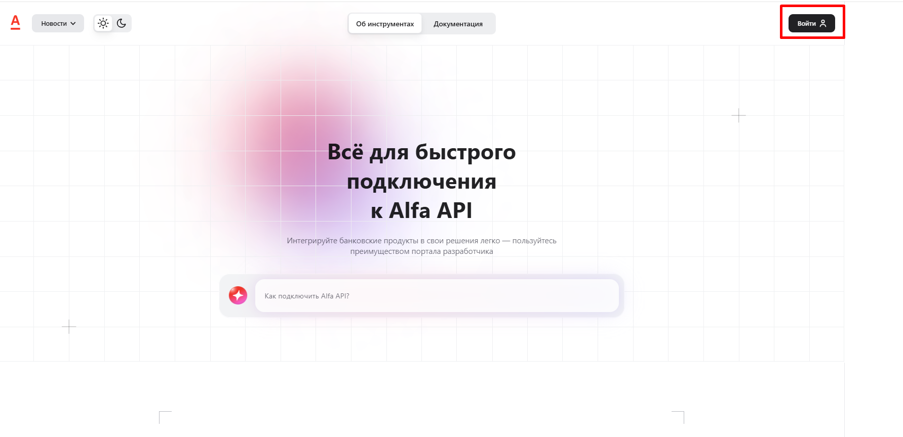{width=1783px height=864px}


**Шаг 2. Переход к настройкам H2H-интеграции**

1. Включите режим «Песочница» с помощью переключателя в верхней части страницы.

2. Откройте вкладку «Интеграции».

3. Найдите H2H-интеграцию, нажмите на три точки справа от неё и выберите «Редактировать интеграцию».

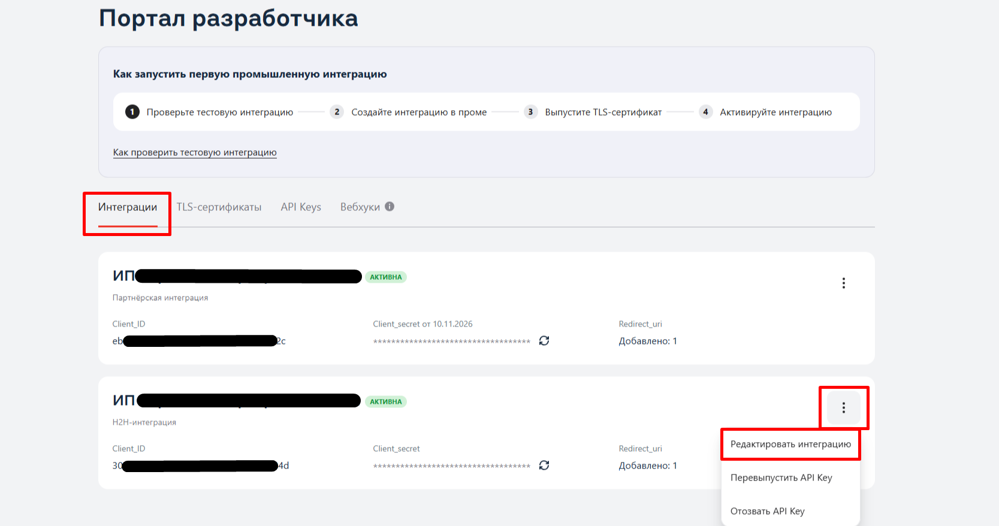{width=1667px height=878px}


**Шаг 3. Настройка интеграции**

1. Укажите любое название интеграции.

2. В поле `Redirect_uri` вставьте ссылку, которую можно получить в административной панели сайта: «Настройки -> Интеграции -> Финансы -> Альфа Банк». Откройте интеграцию и скопируйте адрес из строки браузера.

3. В списке сервисов выберите только `transactions`.

4. Нажмите «Сохранить».

[tabs]

[tab:Название и Redirect_uri]

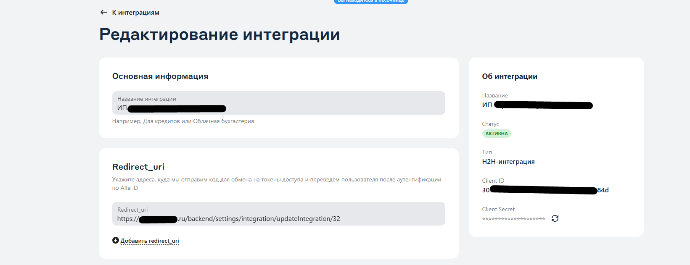{width=1641px height=631px}

[/tab]

[tab:Сервисы и продукты банка]

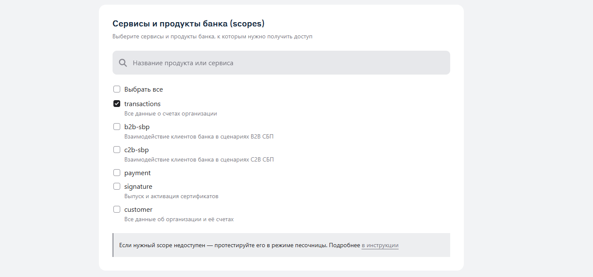{width=1391px height=650px}

[/tab]

[/tabs]


**Шаг 4. Получение тестовых сертификатов**

Обратитесь в техническую поддержку Альфа-Банка с просьбой предоставить архив с тестовыми сертификатами. При запросе укажите ИНН юридического лица.

Пароль от архива обычно предоставляется вместе с ответом. Если пароль не указан, уточните его у своего персонального менеджера в Альфа-Банке.

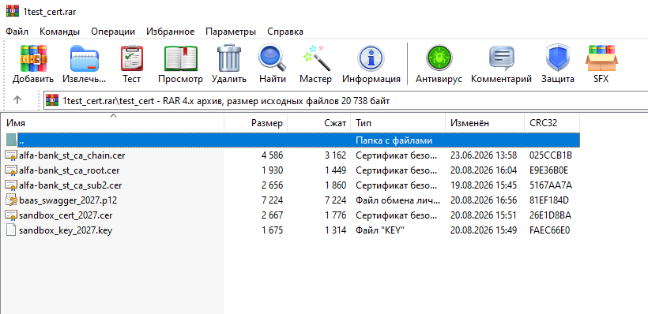{width=820px height=398px}


**Шаг 5. Выпуск тестового API Key**

1. Вернитесь к тестовой H2H-интеграции.

2. Нажмите кнопку выпуска API Key.

3. В поле «Тип IP-запроса» выберите «Статический».

4. В появившемся поле IP-адреса укажите  IP: `45.138.160.19`

5. В разделе «Сервисы и продукты банка» выберите `transactions`.

6. Сохраните настройки.

7. В появившемся окне нажмите «Скопировать».

Обязательно сохраните полученный API Key. После закрытия окна посмотреть его повторно будет невозможно -- в таком случае потребуется перевыпустить ключ.

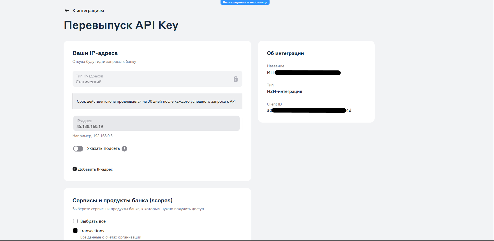{width=1763px height=859px}


## 2\. Проверка тестовой интеграции

После получения тестового API Key необходимо проверить работу интеграции на сайте.

1. Откройте административную панель сайта.

2. Перейдите в «Настройки -> Интеграции -> Финансы -> Альфа Банк».

3. Выберите необходимые реквизиты.

4. В поле «Токен» вставьте полученный тестовый API Key.

5. В поле «Сертификат» загрузите файл `baas_swagger_2027.p12` из архива с тестовыми сертификатами.

6. Сохраните настройки.

7. Создайте тестовый заказ с оплатой по счёту и проведите оплату.

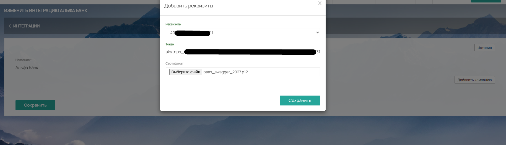{width=1829px height=528px}


Если тестирование прошло успешно, в Портале разработчика Альфа-Банка появится отметка о прохождении пункта «Проверьте тестовую интеграцию».

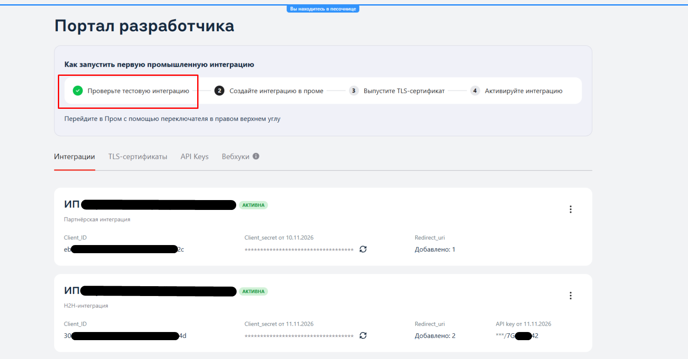{width=1605px height=838px}


## 3\. Создание промышленной интеграции

После успешного тестирования можно переходить к настройке рабочей интеграции.

1\. В верхней части Портала разработчика переключите режим «Песочница» на «Пром».

2\. Откройте вкладку «Интеграции».

3\. Нажмите «Создать интеграцию».

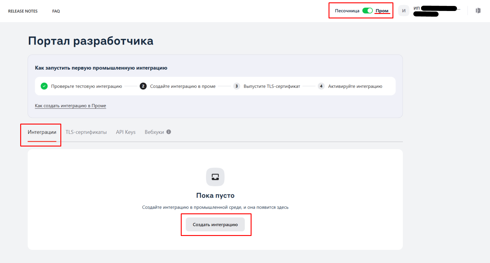{width=1648px height=885px}


4\. В качестве типа интеграции выберите «H2H-интеграция» и нажмите «Продолжить».

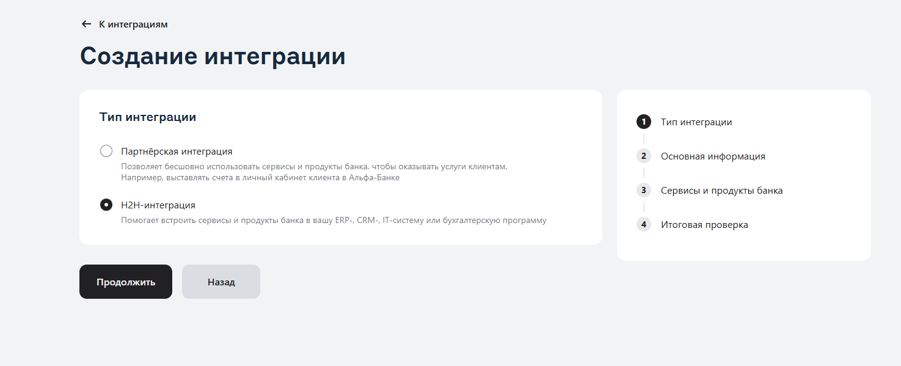{width=1475px height=599px}


5\. Укажите название интеграции, например «Проставление оплаты по счетам».

6\. В поле `Redirect_uri` вставьте ту же ссылку, которую использовали при настройке тестовой интеграции.

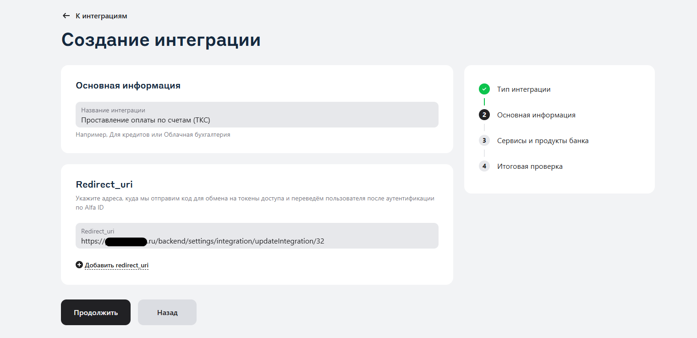{width=1521px height=737px}


7\. В разделе «Сервисы и продукты банка» отметьте `transactions`.

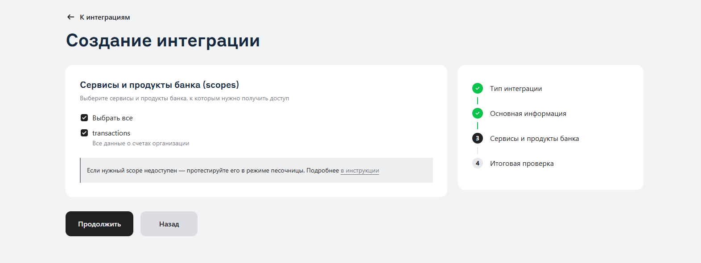{width=1572px height=590px}


8\. Проверьте введённые данные и нажмите «Создать интеграцию».

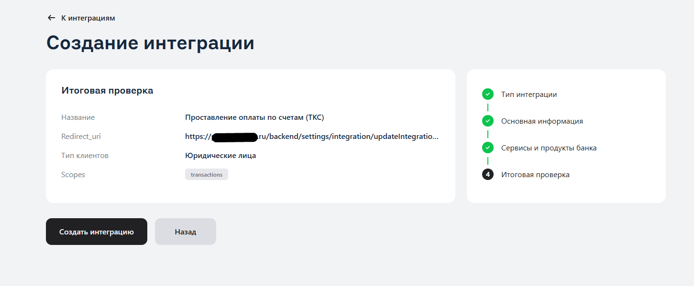{width=1451px height=599px}


В списке интеграций новая интеграция отобразится со статусом «Заблокирована». На этом этапе это нормально.

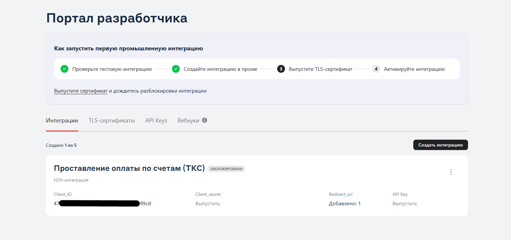{width=1569px height=739px}


## 4\. Выпуск промышленного TLS-сертификата

Для работы промышленной интеграции необходимо выпустить TLS-сертификат. В результате этого этапа будут получены файлы, необходимые для создания сертификата формата `.pfx`.

### 4\.1. Подготовка программ и файлов

Для работы в Windows потребуется программа OpenSSL.

1\. Скачайте OpenSSL для своей версии Windows (32- или 64-разрядной системы): [Скачать OpenSSL](https://slproweb.com/products/Win32OpenSSL.html).

2\. Достаточно установить версию Light.

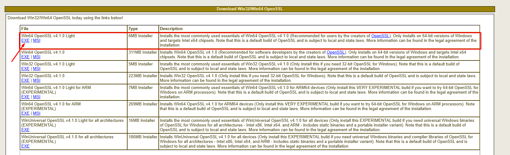{width=1636px height=500px}


3\. Скачайте конфигурационный файл `openssl_INNLE.cnf` из [официальной инструкции Альфа-Банка](https://developers.alfabank.ru/products/alfa-api/documentation/articles/connection/articles/tls/tls).

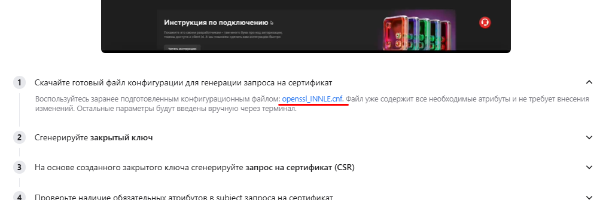{width=1018px height=335px}


4\. Создайте на компьютере папку для работы с сертификатами, например `D:\cert`.

5\. Поместите скачанный файл `openssl_INNLE.cnf` в эту папку.


### 4\.2. Создание закрытого ключа

1\. Откройте скачанный OpenSSL.

2\. Перейдите в созданную папку командой:

```
cd /d "D:\cert"
```

Если вы выбрали другую папку, указав свой путь.

3\. Для проверки содержимого папки выполните:

```
dir
```

В списке должен присутствовать файл `openssl_INNLE.cnf`.

4\. Создайте закрытый ключ командой:

```
openssl genrsa -des3 -out Company.key 2048
```

5\. Придумайте пароль и введите его. Затем повторите пароль для подтверждения.

**Важно:** при вводе пароля символы не отображаются на экране -- это нормально. Обязательно сохраните пароль, он понадобится на следующих этапах.

После выполнения команды в папке появится файл `Company.key`.

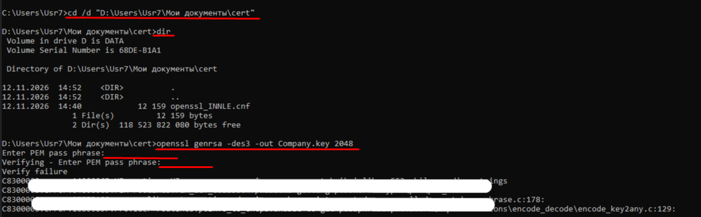{width=1198px height=372px}


### 4\.3. Создание запроса на сертификат (CSR)

На основе созданного закрытого ключа необходимо сформировать запрос на сертификат.

Выполните команду:

```
openssl req -utf8 -config openssl_INNLE.cnf -key Company.key -new -sha256 -out Company.csr
```

Сначала введите пароль от закрытого ключа `Company.key`.

Затем OpenSSL запросит данные для сертификата:

| Поле                       | Что указать                               |
|----------------------------|-------------------------------------------|
| `countryName`              | `RU`                                      |
| `localityName`             | Город                                     |
| `organizationName`         | Название организации или ИП               |
| `Common Name`              | ФИО представителя организации             |
| `Email Address`            | Рабочая электронная почта для уведомлений |
| `INN`                      | Оставить пустым для юридических лиц и ИП  |
| `INNLE`                    | ИНН юридического лица или ИП              |
| `SNILS`                    | Оставить пустым, если не требуется        |
| `CLIENT_ID`                | Идентификатор промышленной интеграции     |
| `A challenge password`     | Оставить пустым                           |
| `An optional company name` | Оставить пустым                           |

Название города, организации и ФИО можно вводить кириллицей или латиницей.

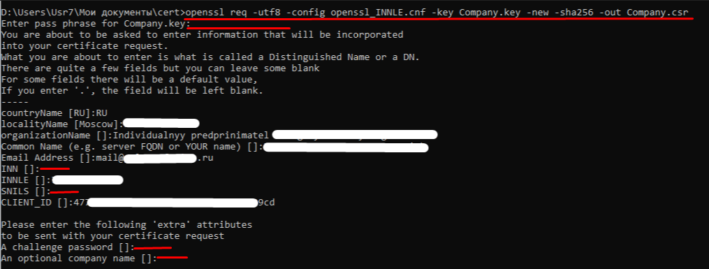{width=1015px height=385px}


После заполнения данных будет создан файл `Company.csr` -- запрос на сертификат.

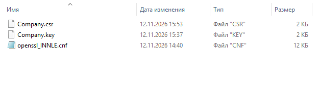{width=625px height=180px}


Не закрывайте командную строку: она понадобится на следующих этапах.


### 4\.4. Выпуск и скачивание промышленного сертификата

1\. Вернитесь в Портал разработчика Альфа-Банка.

2\. Откройте вкладку «TLS-сертификаты».

3\. Нажмите «Выпустить сертификат».

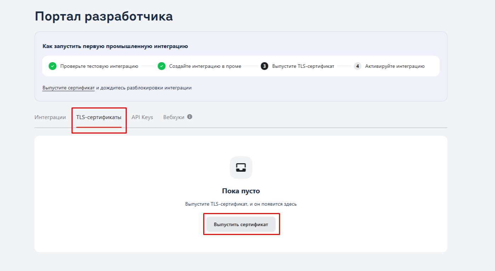{width=1398px height=767px}


4\. Укажите рабочую электронную почту. На неё будут приходить уведомления о состоянии сертификата и необходимости его обновления.

5\. Выберите созданную промышленную интеграцию.

6\. В поле запроса на сертификат (CSR) загрузите файл `Company.csr`.

7\. Нажмите «Выпустить».

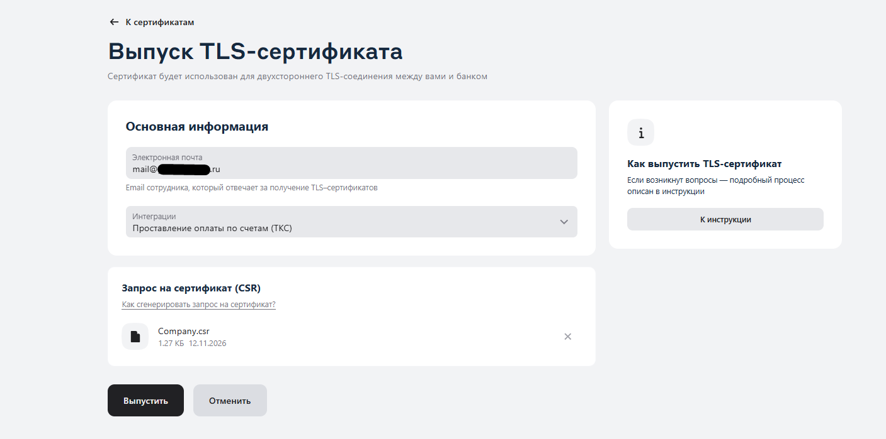{width=1407px height=699px}


8\. После выпуска сертификат появится в списке. Скачайте его.

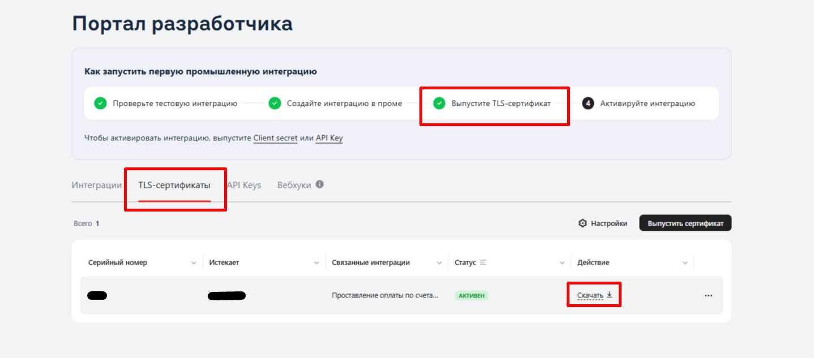{width=1438px height=633px}


Скачанный сертификат будет иметь имя вида `certificate-0000.cer`.

Поместите его в рабочую папку `D:\cert`, где находятся `Company.key` и `Company.csr`.


### 4\.5. Подготовка сертификатов удостоверяющего центра

Из архива с сертификатами, который вы получили от Альфа-Банка, скопируйте в рабочую папку два файла:

-  `alfa-bank_st_ca_root.cer` -- корневой сертификат.

-  `alfa-bank_st_ca_sub2.cer` -- промежуточный сертификат.

В результате в рабочей папке должны находиться:

-  `Company.key` -- закрытый ключ.

-  `Company.csr` -- запрос на сертификат.

-  `certificate-0000.cer` -- промышленный сертификат Альфа-Банка.

-  `alfa-bank_st_ca_root.cer` -- корневой сертификат.

-  `alfa-bank_st_ca_sub2.cer` -- промежуточный сертификат.

Для проверки выполните команду:

```
dir
```

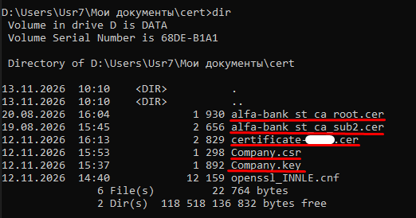{width=522px height=274px}


### 4\.6. Создание PFX-файла

Для установки сертификата в систему необходимо собрать файл формата `.pfx`.

В командной строке, находясь в рабочей папке, выполните команду:

```
openssl pkcs12 -export -out Company.pfx -inkey Company.key -in certificate-0000.cer -certfile alfa-bank_st_ca_root.cer -certfile alfa-bank_st_ca_sub2.cer
```

Вместо `certificate-0000.cer` укажите фактическое имя скачанного сертификата (серийный номер другой).

OpenSSL запросит пароли:

1. `Enter pass phrase for Company.key` -- введите пароль, который задавали при создании закрытого ключа.

2. `Enter Export Password` -- введите пароль для создаваемого PFX-файла. Для получения этого пароля обратитесь в [техническую поддержку Wow2Print](https://tippo.okdesk.ru/).

3. `Verifying - Enter Export Password` -- повторно введите тот же пароль.

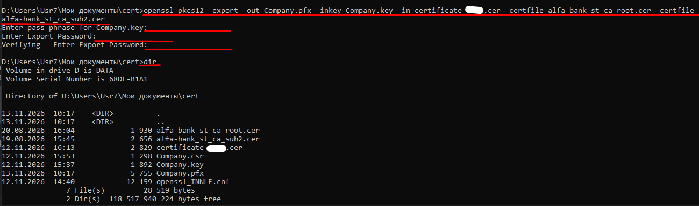{width=1300px height=385px}


После успешного выполнения команды в папке появится файл `Company.pfx`.

Именно этот файл потребуется загрузить в настройки интеграции на сайте.

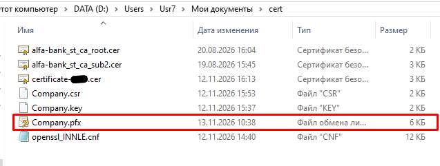{width=637px height=241px}


**Важно:**

-  `Company.key` -- закрытый ключ. Храните его в безопасном месте и не передавайте третьим лицам.

-  Не удаляйте закрытый ключ: он понадобится при перевыпуске сертификата.

-  Пароль от PFX-файла сохраните -- он может понадобиться при дальнейшей работе с сертификатом.

## 5\. Выпуск промышленного API Key

После получения PFX-файла необходимо выпустить промышленный API Key.

1\. В Портале разработчика откройте вкладку «API Keys».

2\. Нажмите «Выпустить API Key».

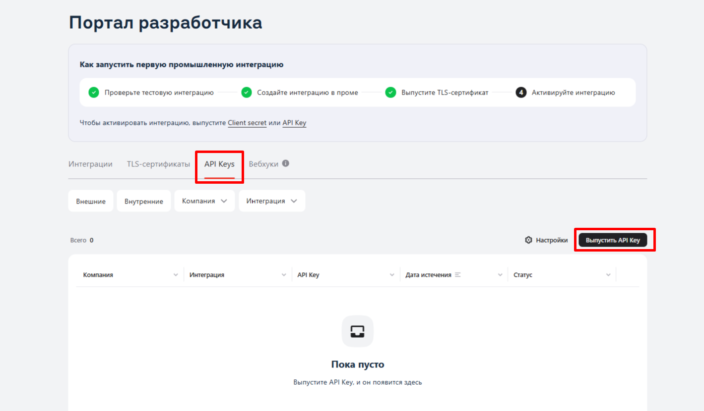{width=1419px height=830px}


3\. В появившемся окне выберите вариант «Внутренний».

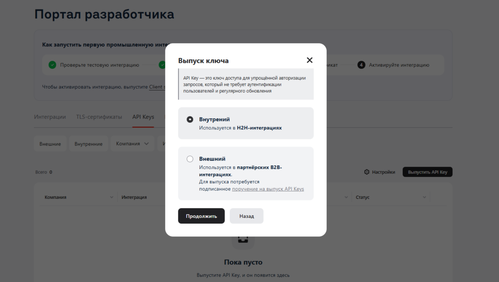{width=1391px height=785px}


4\. На следующей странице выберите созданную ранее промышленную интеграцию и нажмите «Продолжить».

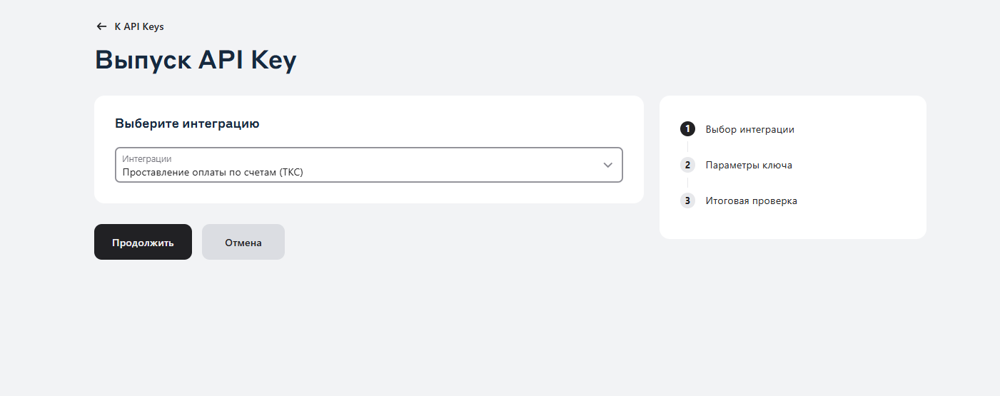{width=1401px height=555px}


5\. На втором этапе выберите тип IP-адреса «Статический».

6\. Укажите IP-адрес сервера, используемый для подключения к API Альфа-Банка:`45.138.160.19`

7\. В разделе «Сервисы и продукты банка» выберите `transactions`.

8\. Нажмите «Продолжить».

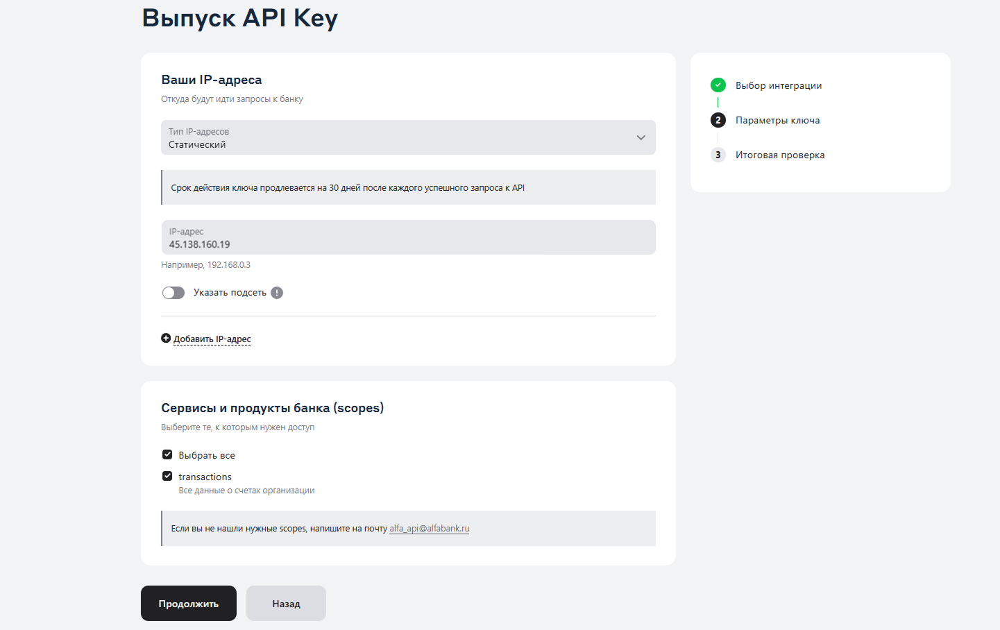{width=1441px height=908px}


9\. Проверьте введённые данные и нажмите «Выпустить ключ».

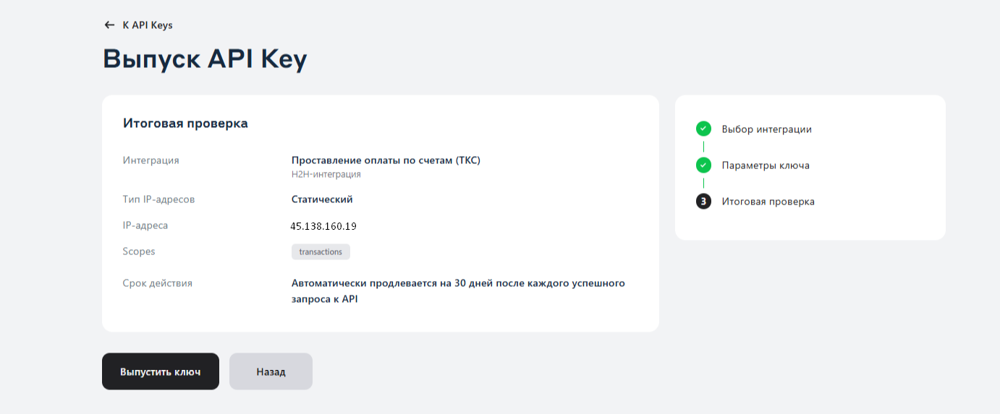{width=1382px height=573px}


Обязательно скопируйте и сохраните API Key. После закрытия окна его повторный просмотр будет недоступен.

Готово! Новый API Key появится в списке ключей.

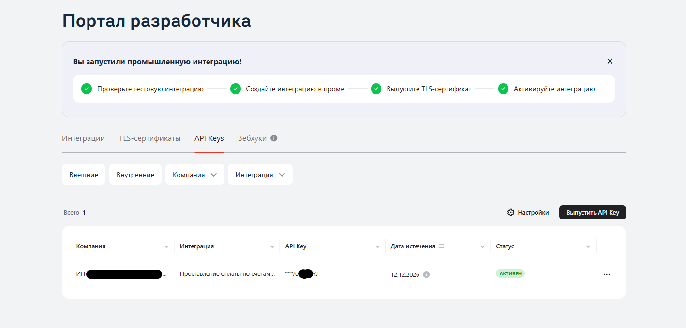{width=1418px height=680px}


## 6\. Подключение интеграции на сайте Wow2Print

Теперь все необходимые данные получены. Осталось указать их в административной панели сайта.

1. Откройте административную панель сайта.

2. Перейдите в «Настройки -> Интеграции -> Финансы -> Альфа Банк».

3. Выберите необходимые реквизиты.

4. В поле «Токен» вставьте полученный промышленный API Key.

5. В поле «Сертификат» загрузите файл `Company.pfx`.

6. Нажмите «Сохранить».

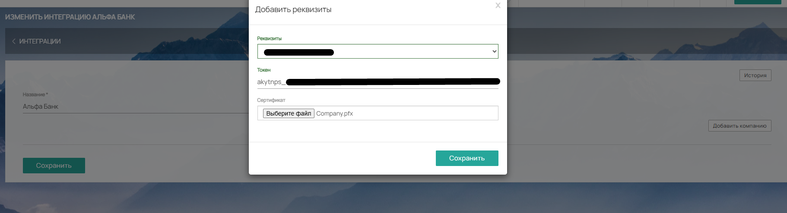{width=1822px height=494px}


Интеграция настроена!


## 7\. Проверка работы интеграции

Чтобы убедиться, что всё подключено правильно:

1. Создайте на сайте заказ с оплатой по счёту.

2. Проведите оплату через Альфа-Банк.

3. После поступления оплаты проверьте статус счёта в административной панели сайта.

Если интеграция работает корректно, статус счёта автоматически изменится на «Оплачен».

\[СКРИНШОТ 23. Счёт после успешной автоматической отметки оплаты\]

## 8\. Продление TLS-сертификата

Срок действия TLS-сертификата составляет **365 дней**.

По истечении срока действия необходимо выпустить новый сертификат. Следите за уведомлениями, которые приходят на электронную почту, указанную при создании CSR.

При повторном выпуске сертификата обратите внимание: если используется новый закрытый ключ, его необходимо учитывать при создании нового PFX-файла.


Интеграция позволяет автоматически отмечать счета оплаченными после поступления оплаты через Альфа-Банк.


## 1\. Настройка тестовой интеграции в Альфа-Банке

1. Зарегистрируйтесь и войдите в [Портал разработчика Альфа-Банка](https://developers.alfabank.ru/).

2. Вы окажитесь на портале разработчика. Перед тем как создавать рабочую интеграцию, вам необходимо протестировать её в режиме «Песочница» (тумблер сверху страницы) должен быть успешным хотя бы один отправленный запрос

3. Найдите во вкладке «Интеграции» «H2H-интеграция» и справа от неё нажмите три точки и выберите «Редактировать интеграцию»

4. В открывшейся странице введите своё название интеграции, ниже введите Redirect_uri его нужно взять в админ панели Настройки -> Интеграции -> Финансы -> Альфа Банк, зайдите в интеграцию и скопируйте ссылку прямо в окне браузера и вставьте ей в эту строку

5. Ниже, из перечисленного списка выберите только transactions

6. Нажмите сохранить

7. Далее вам необходимо написать в тех поддержку что бы они прислали вам архив с тестовыми сертификатами. Пароль от архива они обычно прикрепляют к сообщению, либо уточните пароль у своего личного менеджера в Альфа Банке. При запросе сертификата укажите свой ИНН ЮЛ

   В тексте сообщения можете написать следующее:

8. Затем выпустите API-key. Справа в тестовой интеграции h2h нажмите соответствующую кнопку и вас перебросит на страницу

9. В строке «Тип IP-запроса» укажите «Статический», ниже появится строка «IP-адрес» Вставьте в неё следующий IP 188.234.17.202. Это тестовый ip-адрес. Ниже выберите «Сервисы и продукты банка» наш скоп «transactions»

10. Сохраните

11. Выйдет окно, где необходимо нажать кнопку «Скопировать» после чего обязательно сохраните этот ключ иначе он больше не появится нигде. В крайнем случае придётся перевыпускать ключ

## 2\. Проверка тестовой интеграции

1. Далее необходимо провести тестовый заказ. в Админ панели сайта -> Настройки -> Интеграции -> Финансы -> Альфа Банк, выберите свои реквизиты, вставьте полученный API-key и загрузите из присланного вам архива файл baas_swagger_2027.p12

2. Сохраните

3. Сделайте тестовый заказ с оплатой по счёту и проведите оплату.

4. Если всё сделано успешно, то в Портале разарботчика появится галочка на пункте «Проверьте тестовую интеграцию»

   

## 3\. Создание интеграции в проме

1. Теперь вверху преключите режим «Песочница» на «Пром»

2. Во вкладке «Интеграции» пропадут тестовые интеграции и появится кнопка «Создать интеграцию». Нажмите на неё

3. Выберите «Тип интеграции» - «Н2Н-интеграция». Продолжить

4. Введите своё любое название интеграции. К примеру «Проставление оплаты по счетам»

5. В Redirect_uri вставьте ту же ссылку из браузера в интеграции ТКС. Продолжить

6. В следующем окне выберите Сервисы и продукты банка, поставьте галочку на transactions. Продолжить.

7. В последнем окне проверьте все ли данные указаны верно и нажмите «Создать интеграцию»

8. В списке интеграций появится ваша интеграция с пометкой «Заблокирована» это нормально.


## 4\. Выпуск TLS-сертификата

1. Если вы пользуетесь Mac то можете посмотреть инструкция по выпуску сертификата на оф сайте: <https://developers.alfabank.ru/products/alfa-api/documentation/articles/connection/articles/tls/tls>

2. Скачайте программное обеспечение OpenSSL. Можете скачать тут последнюю версию для своей 32 или 64 разрядной системы: <https://slproweb.com/products/Win32OpenSSL.html> Достаточно будет версии Light

3. Скачайте конфигурационный файл `openssl_INNLE.cnf` из [официальной инструкции Альфа-Банка](https://developers.alfabank.ru/products/alfa-api/documentation/articles/connection/articles/tls/tls).

4. Создайте на компьютере папку, например `D:\cert`, и поместите туда скачанный файл.

Создание закрытого ключа

1. Откройте программу OpenSSL и вставьте команду с путём до вашей папки где хранится файл

   ```
   cd /d "D:\cert"
   ```

2. Для самопроверки можете выполнить команду dir посел чего должно открыться содержимое выбранной папки

3. Выполните команду:

   ```
   openssl genrsa -des3 -out Company.key 2048
   ```

   Придумайте любой пароль, ведите его, нажмите enter и введите его ещё раз. При вводе символы не отображаются -- это нормально. Сохраните пароль.

Создание CSR-запроса

Выполните команду:

```
openssl req -utf8 -config openssl_INNLE.cnf -key Company.key -new -sha256 -out Company.csr
```

Введите запрашиваемые данные:

-  `countryName` -- `RU`.

-  `localityName` -- город.

-  `organizationName` -- название организации.

-  `Common Name` -- ФИО представителя организации.

-  `Email Address` -- рабочая электронная почта.

-  `INN` -- оставить пустым для ИП и юридических лиц.

-  `INNLE` -- ИНН вашей организации или ИП.

-  `SNILS` -- оставить пустым, если не требуется.

-  `CLIENT_ID` -- идентификатор промышленной интеграции. 

-  `A challenge password` -- оставить пустым.

-  `An optional company name` -- оставить пустым.

Название города, организации и ФИО можно вводить кириллицей или латиницей.

После заполнения данных появится файл `Company.csr`.

Не закрывайте программу OpenSSL она нам ещё пригодится дальше

### Получение сертификата

1. Дале вернитесь в Портал разарботчика, найдите вкладку «TLS-сертификаты» Нажмите кнопку «Выпустить сертификат»

2. Введите свою почту, на неё будут приходить уведомления о состоянии сертификата (раз в год перевыпуск)

3. Выберите интеграцию к ккоторой относится данный сертификат

4. В окно «ЗАпрос на сертификат (CSR) прикрепите созданный файл .csr

5. Нажмите «Выпустить»

6. Теперь в списке сертификатов появился ваш сертификат. Нажмите у него кнопку «Скачать» и скачайте новый сертификат certificate-0000.cer. Поместите его в нашу рабочую папку к `Company.csr`

7. Теперь нужно из архива, который вам прислали из Альфа Банка скопировать два файла `alfa-bank_st_ca_root.cer` и `alfa-bank_st_ca_sub2.cer` и вставить их в рабочую папку к основному сертификату.

8. Возвращаемся к программе OpenSSL

9. Для самопроверки всех нужных нам файлов введите команду `dir`, должны быть файлы:

   -  `Company.key` -- закрытый ключ.

   -  `certificate-1736.cer` -- промышленный сертификат Альфа-Банка.

   -  `alfa-bank_st_ca_root.cer` -- корневой сертификат.

   -  `alfa-bank_st_ca_sub2.cer` -- промежуточный сертификат.

Создаём PFX-файл

1. В той же командной строке CMD скопируй и выполни команду:

   openssl pkcs12 -export -out Company.pfx -inkey Company.key -in certificate-1736.cer -certfile alfa-bank_st_ca_root.cer -certfile alfa-bank_st_ca_sub2.cer

2. OpenSSL может запросить:

   1. `Enter pass phrase for Company.key:` -- введи пароль, который задавал при создании закрытого ключа.

   2. `Enter Export Password:` -- Для написания этого пароля запросите его у нас в тех. поддержке (ссылка).

   3. `Verifying - Enter Export Password:` -- повтори новый пароль который запросили в тех поддержке у нас.

3. В папке должен появится сертификат `Company.pfx` который нам нужен для загрузки.

**Важно:** файл `Company.key` -- это закрытый ключ. Его необходимо хранить в безопасном месте и не передавать третьим лицам. Для подключения на сайте используется полученный от банка сертификат, а не закрытый ключ.


Выпуск API key

1. Теперь перейдите на вкладку «API Keys»

2. Нажмите кнопку «Выпустить API Key»

3. В появившемся окне выберите вариант «Внутренний»

4. Дальше на открывшейся странице выберите нужную интеграцию. Продолжить

5. На втором этапе выберите тип ip-адреса «Статический»

6. Ниже укажите ip-адрес 45.138.160.19

7. Ещё ниже выберите сервисы и продукты банка - «transactions». Продолжить

8. На третьем этапе проверьте итоговую информацию и нажмите «Выпустить ключ»

9. Готово. В списке ключей появился наш созданный ключ

Активировать интеграцию в ТКС

1. Все полученные данные вставьте в Интеграцию в ТКС (Настройки -> Интеграции -> Финансы -> Альфа Банк)

2. Выберите реквизиты, вставьте в поле Токе полученный нами API-ключ, в строку Сертификаты загрузите полученный ранее сертификат `Company.pfx`. Нажмите Сохранить.

3. Готово

## Проверка работы

Создайте счёт и проведите оплату через Альфа-Банк. После поступления оплаты проверьте, что статус счёта на сайте автоматически изменился на «Оплачен».

**Обратите внимание:** TLS-сертификат имеет ограниченный срок действия. Следите за уведомлениями на указанной при создании CSR электронной почте и своевременно выпускайте новый сертификат.